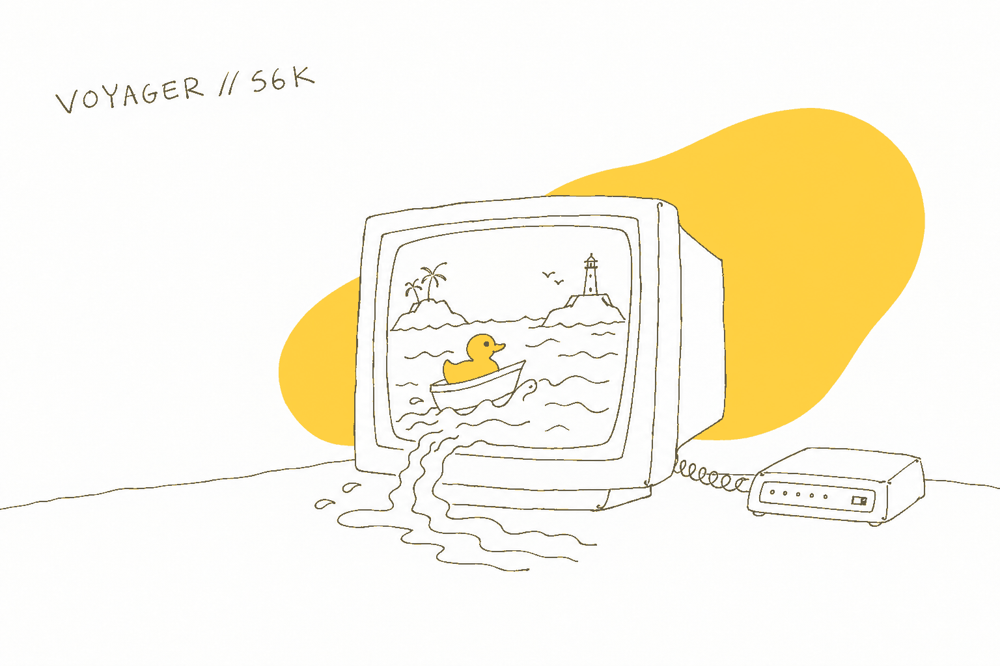

  

# VOYAGER // 56K

**▶ Play: [arudaev.github.io](https://arudaev.github.io)** · just the list: [arudaev.github.io/#/index-plain](https://arudaev.github.io/#/index-plain)

The year is 1999. The internet flooded, and websites became islands. You are Harold, a rubber duck in a small boat, and every island you can sail to is a real project of mine.

This is my portfolio, made as a small game. It renders the way a PlayStation did in 1999, then shows the picture on a curved CRT. Dock at an island and you get the actual project: what it is, three numbers you can check yourself, and links to the code, the paper or the live app. It works on a phone, and you can install it like an app.

I'm Alex, an AI student at TH Deggendorf. – [LinkedIn](https://www.linkedin.com/in/arudaev/) · [GitHub](https://github.com/arudaev)

---

## What's out there

| Island | Project | Open it |
|---|---|---|
| The Ribcage | **CheXVision** – two models read 112,120 chest X-rays; the borrowed DenseNet beat the one we built | [paper](https://arudaev.github.io/chexvision/report/) · [repo](https://github.com/arudaev/chexvision) · [demo](https://huggingface.co/spaces/arudaev/chexvision-demo) |
| Containership & Iceberg | **Titanic ML Platform** – five services, a team of seven | [repo](https://github.com/random-iceberg/docker-compose) |
| Campus Rock | **THD Room Finder** – which study rooms are free right now, and for how long | [live](https://thd-room-finder.vercel.app/) · [repo](https://github.com/arudaev/THD-Room-Finder) |
| The Elevated Rail | **Deutsche Bahn Delay Predictor** – 2.06 million train records, one random forest | [paper](https://arudaev.github.io/ml-db-delay-paper/) · [repo](https://github.com/arudaev/ml-db-delay-paper) |
| Sorting Buoys | **Waste Sorting Assistant** – 466 photos of real German bins and a camera that knows which is which | [live](https://waste-sorting-assistant.streamlit.app/) · [repo](https://github.com/arudaev/Painfully-Trivial) |

Each island links straight in, too: [`/#/island/ribcage`](https://arudaev.github.io/#/island/ribcage) skips the boot and arrives docked (also `containership`, `campus-rock`, `elevated-rail`, `sorting-buoys`).

Around the harbor there's a guestbook (messages wash up as bottles), a mail buoy, and a lighthouse whose keeper's log says who made this and how. Thirteen ducks are adrift somewhere. Past the last ring the sea stops existing.

## How to play

| | Keyboard / mouse | Touch / pen |
|---|---|---|
| Sail | arrows / WASD; drag the cabinet's stick if shown | drag on the sea or the cabinet's stick |
| Dock | Enter, or click the prompt | prompt or `dock` button |
| The chart | M, or `chart` | `chart` / deck B |
| Quack | Space, or `quack` | `quack` / deck A when nothing nearby |
| CRT curve on/off | C, bezel button, or Options | Options → CRT TUBE |
| Monitor / full view | V, view link, or Options → SCREEN | Options → SCREEN when a monitor fits |
| Step back / lean in | `−` / `+`, or labelled controls | Options → STEP BACK; then LEAN IN |
| Text, sound and share links | Options | Options |
| Guided tour | title → TOUR, or T in the world | Options → TITLE → TOUR |
| Browser fullscreen | F or fullscreen control, when supported | Options → FULLSCREEN, when offered |
| Plain project index | skip / power light / Options | Options → SKIP THE BOAT |

Phones start in full view, filling the tab; upright phones can choose a monitor
with a joystick deck. Tablets and Surface computers use the layout that fits
their window. Touch changes hints, not the layout. Full view differs from browser
fullscreen: Sail requests fullscreen where supported, but the browser can decline.

Options uses one service menu across devices. Share View copies room, monitor or
full links; choose LARGE there for a recipient who needs larger text. Normal
links omit the text flag. View-only links keep startup; project island links
arrive docked.

To install: **Install app** in Chrome or Edge, or **Share → Add to Home Screen** on an iPhone.

## How it's made

Everything you see is shader work on a tiny picture:

1. The 3D scene renders into **320×240 pixels**, the PS1's resolution, and is scaled up with no smoothing.
2. Every vertex **snaps to a coarse grid**, because the PS1 had no sub-pixel precision – that's the famous wobble.
3. The ocean's texture is mapped **without perspective correction**, so it swims as you turn.
4. An **8×8 Bayer dither** and **15-bit colour** turn gradients into the hatched bands you remember.
5. A **CRT pass** bends it all into curved glass: scanlines, a phosphor mask, a dark rim, one glare.

The 37 models are built from spheres, cones and boxes in plain three.js code – no modelling program. Every sound, from the quack to the dial-up handshake, is synthesised in the browser; there are no audio files. Every number on an island comes from that project's own paper, README or code.

Built with TypeScript, three.js through React Three Fiber, Vite and zustand; the guestbook and visitor counter run on Supabase. The ideas came from Bruno Simon's driveable portfolio, *Dredge*, *Skies of Arcadia*, *Mega Man Legends*, and the GeoCities web of guestbooks and webrings. I built it with AI tools – Claude for code, OpenAI's image model for the icon, the chart paper and this banner – and checked the facts myself.

## This repository

It holds only the compiled site that GitHub Pages serves; the source is private. Every commit here is one published build, named after the source commit it came from.

Found something broken? Leave a bottle in the guestbook, or [open an issue](https://github.com/arudaev/arudaev.github.io/issues).

Stepped back, click or tap the shelf ducks, moka pot or plant to make the room
answer. Keyboard users can Tab to each object and press Enter or Space.
